<h2>Über mich</h2>

<h2>Aktuelle Schwerpunkte</h2>

<h2>Technologien und Werkzeuge</h2>

<h2>Projekte und öffentliche Präsenz</h2>

<a href="https://github.com/filipg007">GitHub</a> · <a href="https://www.1love-dating.de">Website</a>

<h2>Mein Weg</h2>

<h2>GitHub-Statistiken</h2>

<h2>Beitragsverlauf</h2>

<h2>Kontakt</h2>

<a href="https://github.com/filipg007">GitHub</a> · <a href="https://www.1love-dating.de">Website</a>

Öffentliche GitHub-Daten: 11.10.2026. Momentaufnahme; private Projekte bleiben privat. <a href="https://github.com/filipg007">Aktuellen Stand auf GitHub ansehen</a>.

